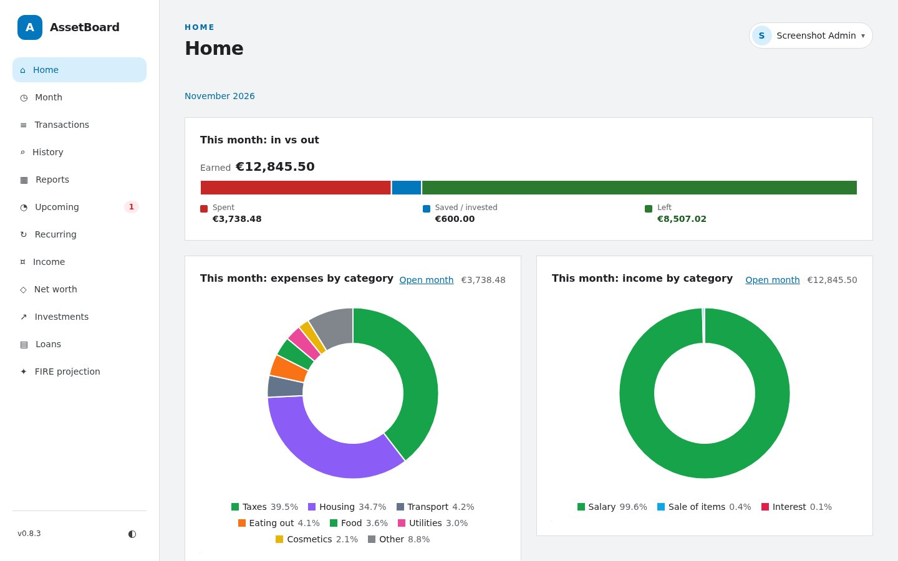
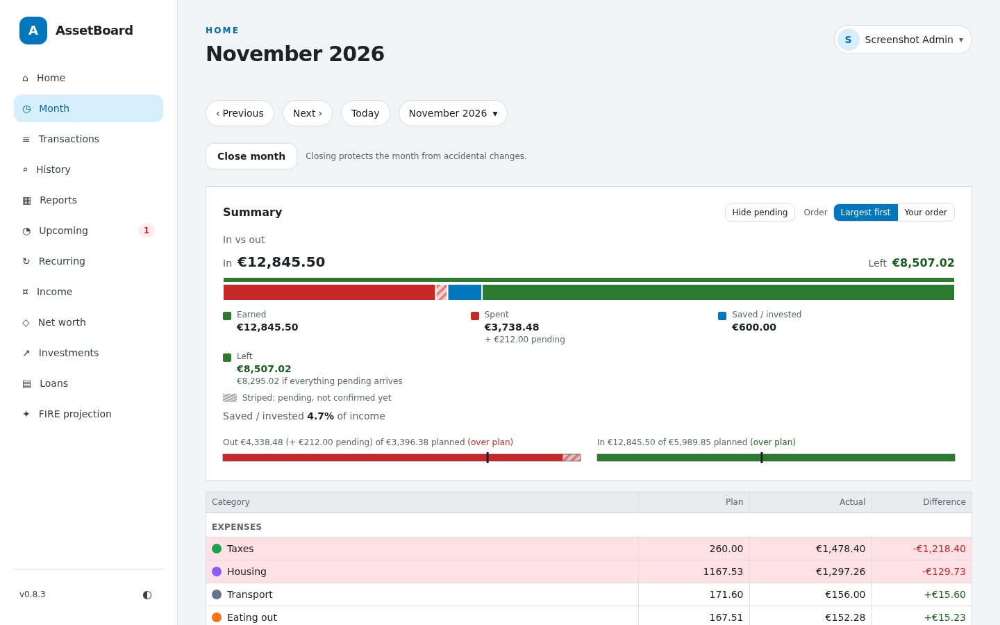
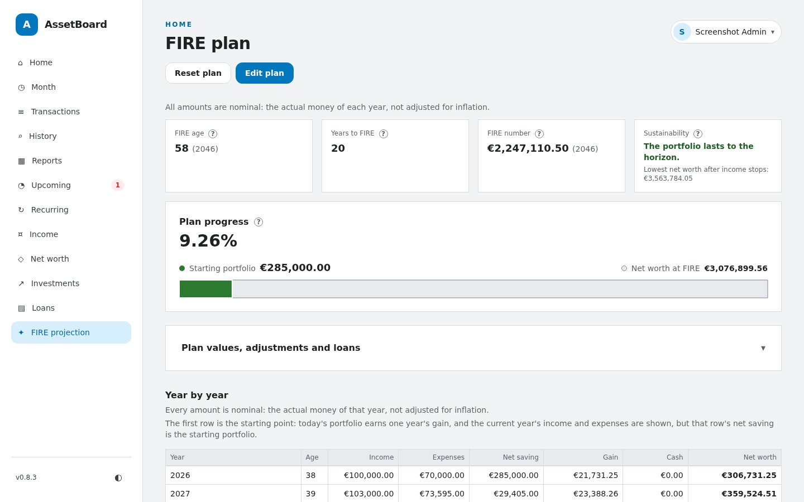

# AssetBoard

**Status: pre-alpha.** AssetBoard is a self-hosted personal-finance web app for tracking monthly
income and expenses, comparing planned with actual spending, and planning net worth, investments,
loans, and financial independence. It aims to give homelab users a private, user-controlled
alternative to spreadsheets and hosted finance services.

**Current state:** local accounts, first-run setup and the app shell work today; finance features
arrive with their milestones.

## Quick start

Docker Compose is the recommended way to run AssetBoard, not the only one: the
[install guides](docs/install/README.md) also cover a native install with systemd on Debian or
Ubuntu, a Proxmox LXC container and rootless Podman. With Docker Engine and Docker Compose v2:

```bash
docker compose -f compose.example.yaml up -d --build
```

Open <http://localhost:8000> and complete first-run setup. The setup form asks for a one-time
setup token, which the container prints once in its log at startup
(`docker compose -f compose.example.yaml logs assetboard | grep "setup token"`), unless you set
`ASSETBOARD_SETUP_TOKEN`. You can also create the administrator from the command line with
`docker compose -f compose.example.yaml exec assetboard assetboard create-admin`. Compose stores the
database and generated secret in a named volume. See the [deployment guide](docs/deployment.md) for
reverse proxies (recommended before exposing the app beyond your machine), bind mounts, image
publishing, and the complete environment-variable reference. The
[security checklist](docs/security-checklist.md) records the ASVS Level 1 review and the known
gaps.

| Variable | Default | Purpose |
| --- | --- | --- |
| `ASSETBOARD_BASE_URL` | `http://localhost:8000` | Public URL used by the app |
| `ASSETBOARD_DEFAULT_LOCALE` | `en` | Default UI language |
| `ASSETBOARD_DEFAULT_CURRENCY` | `EUR` | Default currency |
| `ASSETBOARD_LOG_FORMAT` | `json` in Compose | `text` or `json` logs |
| `ASSETBOARD_TRUSTED_PROXIES` | empty | Proxy IPs/CIDRs allowed to supply forwarded headers; empty trusts no proxy |
| `ASSETBOARD_BIND_ADDRESS` | `127.0.0.1` | Compose-only host interface |
| `ASSETBOARD_HOST_PORT` | `8000` | Compose-only host port |

The full configuration table, including application defaults, is in the
[deployment guide](docs/deployment.md#environment-variables).

## Screenshots

| Home | Month | FIRE |
| --- | --- | --- |
|  |  |  |

The [screenshot gallery](docs/screenshots.md) has every main page in light and dark mode on
desktop and phone. The images come from the deterministic demo dataset; the
[capture script](scripts/capture_screenshots.py) regenerates them.

## Development

```bash
make setup
make dev
make check
```

`make dev` builds local CSS, compiles translations, and starts the reload-enabled server at
`http://127.0.0.1:8000`. See [CONTRIBUTING.md](CONTRIBUTING.md) for the workflow and checks, and
[docs/architecture.md](docs/architecture.md) for the layers and how workspace data is isolated.

## Documentation

**Install and operate**

- [Install guides](docs/install/README.md): Docker Compose, native systemd, Proxmox LXC and rootless Podman.
- [Deployment guide](docs/deployment.md): the complete environment reference, first run, reverse proxies, backups and upgrading.
- [First run and sign-in](docs/deployment.md#first-run-and-sign-in): the setup token and the first administrator.
- [Reverse proxies](docs/deployment.md#reverse-proxies): nginx, Caddy and Traefik examples, TLS, trusted proxies and body limits.
- [OIDC sign-in](docs/auth/oidc.md) and [proxy authentication](docs/auth/proxy-auth.md): SSO and header-based sign-in.
- [Notifications](docs/deployment.md#notifications): Apprise channels and reminders; [price providers](docs/investments.md#price-providers): NBP, CoinGecko, EODHD and GoldAPI.io.
- [Backups and restore](docs/backup.md) and [Upgrading](docs/deployment.md#upgrading).
- [Troubleshooting](docs/troubleshooting.md): start with the log and health endpoints for each symptom.

## User guides

- [Install on your phone](docs/install-on-your-phone.md): add AssetBoard to an Android or iOS home screen (HTTPS required).
- [Home dashboard](docs/dashboard.md): the widget catalogue, defaults and how to customise Home.
- [Your account](docs/accounts.md): profile, sign-in methods and the audit log.
- [Categories](docs/categories.md): expense and income categories, savings and transfers.
- [Months](docs/months.md): moving between months, closing and reopening a month.
- [Import and export](docs/import-export.md): downloading, restoring and merging workspace archives; importing CSV files and converting a spreadsheet.
- [Archive format](docs/archive-format.md): the files and columns of the workspace archive and of importable CSV files.
- [Transactions](docs/transactions.md): entering, editing and deleting expenses and income; searching, CSV export and changing the category of many entries.
- [Reports](docs/reports.md): income against expenses and savings per month or year, the savings-rate trend including a 12-month rolling rate, spending by category over time with a top-8/Other stack, a heat-shaded category × month year overview with CSV export, 3/12-month category trends, year-over-year comparisons and planned-vs-actual accuracy, all under the shared year, granularity and currency filters.
- [Net worth](docs/net-worth.md): assets and liabilities, categories, values and value history.
- [Investments](docs/investments.md): asset classes, instruments, allocation weights and price providers.
- [Loans](docs/loans.md): mortgage and loan terms, rates, costs, overpayments and reference rates.
- [FIRE planner](docs/fire.md): independence scenarios, assumptions, contribution overrides and events.
- [Backups and restore](docs/backup.md): scheduled copies, retention, restore checks, volume snapshots and off-site advice.
- [Workspace settings](docs/workspace-settings.md): name, base currency, time zone and formats.
- [Demo workspace](docs/demo-mode.md): the deterministic sample data, the `demo-seed` command and public demo mode.
- [Screenshots](docs/screenshots.md): every main page in light/dark mode on desktop and phone.

## Roadmap

See the [milestone roadmap](docs/specs/00-overview.md#5-roadmap-and-dependencies) and feature
specifications under `docs/specs/`.

## License

AssetBoard is licensed under the GNU Affero General Public License v3.0 or later. See [LICENSE](LICENSE).
